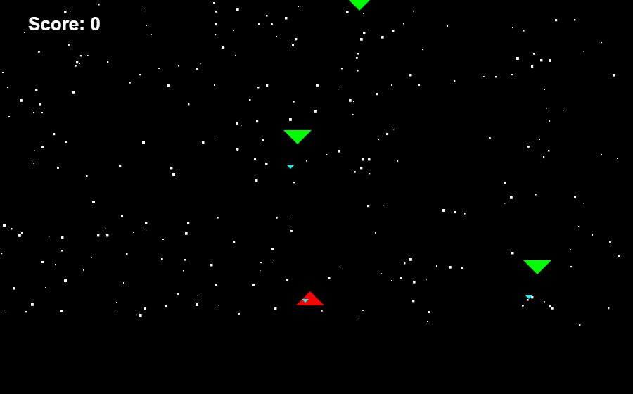
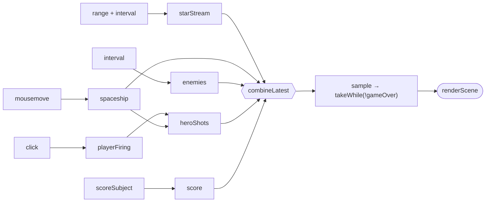

<div align="center">

# 🚀 Spaceship Reactive

**A tiny space shooter built entirely out of RxJS streams.**

[](https://hubertkubiak.github.io/spaship-reactive-game/)


[](LICENSE)



</div>

## About

A practice project for learning reactive programming. There's no game loop, no
classes and no mutable game state manager. Every part of the game (stars, the
player's ship, enemies, bullets, the score) is an **Observable**, and the
whole scene is one `combineLatest` of those streams rendered onto a `<canvas>`.

> [!NOTE]
> This is my re-creation of the spaceship game example from the book
> [*Reactive Programming with RxJS*](https://pragprog.com/titles/smreactjs/reactive-programming-with-rxjs/)
> by Sergi Mansilla (Pragmatic Bookshelf, 2015). I typed it out while working
> through the book. The game design and the original code are the author's.

## How to play

| Action | Control |
| ------ | ------- |
| Move the ship | 🖱️ Mouse |
| Shoot | 🖱️ Click |

- Each enemy you shoot down gives you **+10 points**.
- Touching an enemy or getting hit by one of its bullets ends the game.
- Refresh the page to play again.

## Running locally

No install or build step is needed. RxJS is loaded from a CDN.

```bash
git clone https://github.com/hubertkubiak/spaship-reactive-game.git
cd spaship-reactive-game
```

Then open `index.html` in your browser. You can also serve it:

```bash
npx serve .
```

## How it works



| Stream | What it emits |
| ------ | ------------- |
| `starStream` | The array of stars, moved down every tick to make the scrolling background |
| `spaceship` | The player's position, from `mousemove` |
| `enemies` | A growing array of enemies, one more every `ENEMY_FREQ` ms. Each enemy fires on its own interval |
| `playerFiring` / `heroShots` | Click events, throttled with `sample`, turned into bullets at the ship's x position |
| `score` | A running total built with `scan` over a `Subject` |
| `game` | All of the above combined, sampled once per frame, until a collision ends it |

## Tweaking

The constants at the top of [`spaceship.js`](spaceship.js) change how the game plays:

```js
const SHOOTING_SPEED = 15;        // bullet speed (px per frame)
const SCORE_INCREASE = 10;        // points per kill
const SPEED = 40;                 // frame interval in ms (lower = faster)
const STAR_NUMBER = 250;          // stars in the background
const ENEMY_FREQ = 1500;          // ms between new enemies
const ENEMY_SHOOTING_FREQ = 750;  // ms between enemy shots
```

## Project structure

```
├── index.html      # page shell, loads RxJS from a CDN
├── spaceship.js    # the whole game
└── docs/           # README assets
```

## Credits

Based on the spaceship game from *Reactive Programming with RxJS* by Sergi
Mansilla (Pragmatic Bookshelf, 2015).
